# Skydiving Logbook App

An interactive digital skydiving logbook. Scan handwritten logbook pages, review extracted data, save securely and explore your jumping history through a dashboard built for skydivers.

> **Status:** early development. The repository layer and the frontend are in place, and the whole UI runs on sample data in demo mode. Sign-in, OCR and photo storage are still to come. Single-user by default; designed for multi-user from day one.

---

## Overview

`skydive-log` is a personal logbook application built around three ideas:

1. **OCR-first ingest.** Photograph a logbook page; an LLM-based vision pipeline extracts each jump into structured fields. Every extracted jump goes through a side-by-side human review screen before it's committed.
2. **A dashboard worth opening.** Currency tracking, rolling totals, progression toward British Skydiving licences and grades, a year-in-review experience, and personal-best surfacing. Beta features (drop-zone globe, jump-partner graph, weather) live in their own zone so the core stays polished.
3. **Production-grade by construction.** Ports-and-adapters architecture, every external service swappable, multi-user-ready schema from the first migration, type-safe end-to-end.

This is also a portfolio project: the auth, observability, and infrastructure choices are deliberately industry-relevant.

## Features

### Working now

- Manual jump entry, with drop zone, aircraft, heights and canopy carried over from the previous jump, one-tap exit altitudes, a delay estimate and live deploy-altitude warnings
- Logbook with search and filters (text, drop zone, tag, date range), a page per jump, editing, and archiving (soft delete)
- Today dashboard: currency, recent jumps, a 12-month activity heatmap, rolling 30/90/365-day totals, personal bests and "on this day"
- British Skydiving progression: the A to D licence route, prerequisites for JM1, CT1, CT2, CT3, FS1, FF1, CF1 and TR1, and sign-off checklists for the next licence
- Stats: totals, freefall time and distance, a cumulative jumps chart, breakdowns by drop zone, aircraft and canopy size, all filterable by date range
- Year in review, and a drop-zone globe in the beta zone
- JSON backup export at `/api/export`
- Demo mode: the full app on the in-memory adapters with a 63-jump sample logbook (`DATA_SOURCE=demo`)
- Domain rules and shared repository contracts tested with Vitest, against both the in-memory adapters and PGlite

### Designed, waiting on a port or migration

These screens are built and show sample data in demo mode. With real data they show an empty state until their store exists.

| Feature | Needs |
| --- | --- |
| Tags on jumps, tag management | a `TagRepository` port |
| Equipment inventory and per-item jump history | an `EquipmentRepository` port |
| Licence and grades, sign-offs, your own goals | a progression table and port |
| OCR import: photo, drafts, review, save | `OcrProvider` and `StorageProvider` ports, plus a table for uploaded pages (`jumps.ocr_source_id` has nothing to point at yet) |
| Jump-partner graph (beta) | partners on the jump repository, or a new port |
| Weather on jump days (beta) | a weather port |

### Planned

- Sign-in with Microsoft Entra ID (library choice to be recorded in ADR 0002)
- British Skydiving-format PDF export for licence applications (beta)
- iCalendar feed for currency-expiry reminders (beta)
- A contact form, if the app ever goes public

## Tech stack

| Layer | Choice | Swap target |
| --- | --- | --- |
| Framework | Next.js 16 (App Router) + TypeScript | SvelteKit, Remix |
| Styling | Tailwind CSS v4 with design tokens; shadcn/ui when a primitive needs it | — |
| Auth | Microsoft Entra ID (Auth.js v5 or Better Auth, see ADR 0002) | Auth0, Clerk, Google OIDC |
| Database | PostgreSQL (Neon) via Drizzle ORM | Supabase, Azure PG, self-hosted |
| Object storage | Cloudflare R2 (S3-compatible) | Azure Blob, Backblaze B2, MinIO |
| OCR | Google Gemini 2.5 Flash | Claude Sonnet vision, Azure Document Intelligence |
| Validation | Zod, at the app boundary | — |
| Secrets | Doppler | provider env vars |
| Errors | Sentry (planned) | — |
| Hosting | Vercel Hobby (planned) | Cloudflare Pages, Azure Static Web Apps |
| Package manager | pnpm | — |
| Tests | Vitest, with Playwright planned | — |
| Lint/format | Biome (planned) | ESLint + Prettier |

The external services (database, storage, OCR, identity) each sit behind a port, so swapping one is a single new adapter — see [`docs/ARCHITECTURE.md`](docs/ARCHITECTURE.md). Changing the framework or styling would be a rewrite, not a swap.

## Prerequisites

- Node.js 24 (pinned in `.nvmrc`)
- pnpm 11 (`devEngines` in `package.json` downloads the right version if needed)
- Nothing else for demo mode
- For real data: a Neon project, or any PostgreSQL 15+ instance
- For later milestones: a Microsoft Entra ID app registration, a Google AI Studio API key and a Cloudflare R2 bucket

## Getting started

```bash
git clone https://github.com/JBourton/Skydiving-Logbook-App.git
cd Skydiving-Logbook-App
pnpm install

# demo mode is switched on in the template
cp .env.example .env.local

pnpm dev
```

Open <http://localhost:3000>.

To use your own database instead, remove `DATA_SOURCE` from `.env.local`, set `DATABASE_URL` and `DEV_USER_ID` (your row's `id` in the `users` table), run `pnpm db:migrate`, then `pnpm dev`. `DEV_USER_ID` is ignored in production; real sign-in replaces it.

## Scripts

| Command | What it does |
| --- | --- |
| `pnpm dev` | Next.js dev server with hot reload |
| `pnpm build` | Production build |
| `pnpm start` | Run the production build |
| `pnpm typecheck` | Generates Next's route types, then a TypeScript no-emit check across the repo |
| `pnpm test` | Vitest unit and contract tests |
| `pnpm test:watch` | Vitest in watch mode |
| `pnpm db:generate` | Generate a Drizzle migration from schema changes |
| `pnpm db:migrate` | Apply pending migrations |

`lint` and `format` (Biome), `test:e2e` (Playwright) and `db:studio` arrive with their tools.

## Frontend design

The interface is built to be read on the ground, in bright sun, between loads.

- **Light first.** Blue-black ink on white, and every piece of text that matters clears 7:1 contrast (WCAG AAA). Dark mode is a toggle, stored in a cookie so the first paint is already right.
- **One typeface.** B612, which Airbus designed for cockpit displays read under glare and vibration. Two weights only.
- **One accent.** Glass-cockpit magenta, the colour avionics use for the route being flown, marks progress towards your next licence and keyboard focus. Altimeter red is reserved for safety warnings.
- **The altitude profile.** Every jump is drawn as a solid bar from exit to deploy, then a thin line for the canopy ride. It appears in logbook rows, as the dashboard skyline and the logo, and as a labelled altimeter tape on each jump.
- **No cards, no icon set.** Structure comes from space and tone, and navigation is words.
- **Responsive to its container.** The logbook switches to paper-logbook columns based on the space it's given (a container query), not the window size.

Design tokens live in `src/app/globals.css`. Tailwind's default palette and type scale are cleared, so only the tokens can be used.

## Architecture diagrams

Two diagrams summarise the system design. Both live in [`docs/architecture_diagrams/`](docs/architecture_diagrams/). The system diagram's "Next.js 15" label predates the move to Next.js 16.

### System architecture



Shows the overall system: Next.js app, ports/adapters, external services (Neon/PostgreSQL, Cloudflare R2, Gemini OCR, Microsoft Entra ID), and data flow from a scanned logbook page through extraction, review, and committed storage.

### Ports and adapters



Shows the hexagonal layout: domain core surrounded by port interfaces, with concrete adapters (Drizzle, R2, Gemini, Entra) plugged in at the edges. Illustrates the dependency direction — adapters depend on ports, never the reverse.

## Project structure

```
src/
  app/
    (app)/          # signed-in routes: Today, logbook, progress, stats, gear, settings, beta, year in review
    (marketing)/    # public routes: sign in, about, contact
    api/export/     # JSON backup
  components/       # React components, server components by default
  domain/           # pure business logic, no I/O: BS progression, currency, stats, dates
  ports/            # interfaces describing what the app needs from outside
  adapters/
    db/             # Drizzle schema and Neon-backed repositories
    memory/         # in-memory repositories for tests and demo mode
  lib/              # composition root (services.ts), user seam, form schema, formatting, demo data
  test-support/     # PGlite harness and the shared repository contracts
drizzle/            # generated SQL migrations
docs/
  ARCHITECTURE.md   # deep architectural overview
  adr/              # Architecture Decision Records
  architecture_diagrams/
```

See [`docs/ARCHITECTURE.md`](docs/ARCHITECTURE.md) for the rationale behind this layout.

## Deployment

The planned target is Vercel (free Hobby tier), with Cloudflare Pages and Azure Static Web Apps as fallbacks. Nothing is deployed yet, and there are no CI or deploy workflows in the repo yet. A demo deployment with `DATA_SOURCE=demo` is safe to make public, since it has no access to real data.

Environment variables are documented in [`.env.example`](./.env.example).

## Roadmap

Progress is tracked in [GitHub Issues](../../issues). A `docs/ROADMAP.md` is still to be written.

## Contributing

This is a single-developer project for now. If you're an AI coding assistant, read [`AGENTS.md`](AGENTS.md) first.

## Security

To report a vulnerability, please open a private security advisory on this GitHub repository rather than a public issue.

## Licence

TBD. The project will be source-available; the licence file will be added before any third-party contribution is accepted.

## Acknowledgements

- British Skydiving for the progression frameworks the app encodes
- Airbus and the B612 project for the typeface (SIL Open Font License)
- The open-source community behind every package in `package.json`
